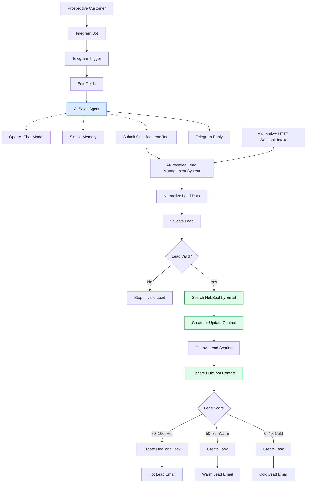

# AI-Powered Lead Management System

An AI-assisted lead intake and CRM automation built with **n8n**, **OpenAI**, **HubSpot**, **Telegram**, and **Gmail**.

The complete solution has two connected workflows: a Telegram-facing **AI Sales Agent** that converses with prospective customers, and a **Lead Management** sub-workflow that validates, scores, and manages qualified leads in HubSpot. The lead-management workflow can also accept submissions directly through its webhook.

> **Project status: Functionally tested.** The lead-management webhook path was tested with invalid input, a repeated email address, and Hot, Warm, and Cold lead scenarios. Email notifications and HubSpot tasks were confirmed; the Hot path also created a HubSpot deal. The Telegram AI Sales Agent is a separate entry-point workflow that calls the lead-management workflow. Its sanitized reference export is included in `workflows/ai-sales-agent-telegram.json`. Do not interpret the lead-management workflow JSON alone as containing the Telegram trigger.

## Complete system architecture

The diagram below shows the Telegram-facing AI Sales Agent, its connected model, memory and lead-submission tool, plus the downstream lead-management workflow and its alternative webhook entry point.

The Telegram trigger belongs to the separate AI Sales Agent workflow. The lead-management workflow is called by that agent through its **Submit Qualified Lead** workflow tool / Execute Workflow integration. It also exposes a webhook for direct intake and independent testing.

## What it does

1. **Conversational intake** — the AI Sales Agent interacts with prospects through Telegram and gathers lead information.
2. **Lead handoff** — the agent submits qualified lead details to the lead-management workflow.
3. **Validation** — checks required information and rejects invalid email addresses or incomplete data.
4. **Duplicate protection** — searches HubSpot by email and updates an existing contact rather than creating a second contact.
5. **AI qualification** — evaluates budget, buying intent, clarity, and urgency, then returns a score and sales recommendation.
6. **CRM enrichment** — stores lead score, priority, AI reasoning, and recommended action in HubSpot.
7. **Automated routing** — sends leads into Hot, Warm, or Cold follow-up paths.
8. **Sales actions** — sends Gmail notifications and creates HubSpot tasks; the Hot path also creates a deal.

## Lead scoring

| Category | Score | Automated actions |
|---|---:|---|
| Hot | 80–100 | Gmail notification, high-priority HubSpot task, HubSpot deal |
| Warm | 50–79 | Gmail notification, medium-priority HubSpot task |
| Cold | 0–49 | Gmail notification, low-priority HubSpot task |

## Technology stack

- **Conversational entry point:** Telegram
- **Workflow automation and AI agent:** n8n
- **AI:** OpenAI API
- **CRM:** HubSpot
- **Notifications:** Gmail
- **Logic and transformation:** JavaScript
- **Integration:** REST APIs, JSON, webhooks, sub-workflow execution

## Repository contents

- [Telegram AI Sales Agent workflow export](workflows/ai-sales-agent-telegram.json)
- [n8n lead-management workflow export](workflows/ai-powered-lead-management.json)
- [Setup and import guide](docs/setup.md)
- [Architecture notes](docs/architecture.md)
- [Test results](docs/testing-results.md)

### Trigger and export notes

The **complete solution** is Telegram-triggered through the separate AI Sales Agent workflow, which hands qualified lead data to this lead-management workflow using its **Submit Qualified Lead** tool / Execute Workflow trigger. The lead-management workflow also has a direct HTTP Webhook trigger.

The JSON currently in `workflows/` is an earlier sanitized snapshot of the lead-management workflow. It does not include the separate Telegram AI Sales Agent workflow and does not include all fixes made and verified in the live n8n workflow on November 21, 2026. Treat it as a structural reference, not as a complete export of the entire Telegram-to-CRM system or the latest tested import. A sanitized Telegram AI Sales Agent reference export is now included. The lead-management JSON remains an earlier snapshot and still needs a fresh export before the two files together can be treated as a fully reproducible, current system.

## Security

The public workflow snapshots have had credential references, Telegram/webhook IDs, instance metadata, and personal notification addresses removed. The AI Sales Agent export replaces the downstream workflow ID with a setup placeholder; select your imported lead-management workflow after importing. Configure your own credentials inside n8n.

Never commit API keys, access tokens, passwords, private webhook URLs, customer records, or personal notification addresses. Use synthetic data in public examples.

## Production considerations

The lead-management workflow has passed the functional scenarios documented in [Test Results](docs/testing-results.md), but this is not a claim of production deployment. Before using it with real customers, add/verify error handling, retries, monitoring, secure hosting, data-retention practices, and deployment reliability.

## Author

**Bilal Sankari** — AI Automation Developer

- GitHub: [@bilalsankari](https://github.com/bilalsankari)

### Notes on the Telegram workflow export

The supplied export contains two additional nodes (`Extract Lead Information` and `Structured Output Parser`) that are not connected in the exported workflow graph. The active path shown by the connections runs from Telegram Trigger → Edit Fields → AI Agent → Telegram reply, with OpenAI, memory, and Submit Qualified Lead attached to the agent. The configured lead source is `website_chatbot` even though the transport trigger is Telegram; change it to `telegram` in n8n if you want CRM source reporting to reflect the actual channel. The export is a sanitized reference, not a tested portable import: reconnect credentials and select the downstream workflow after import.
